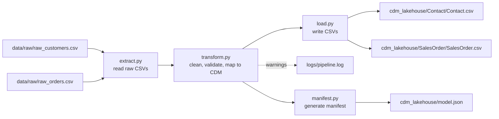
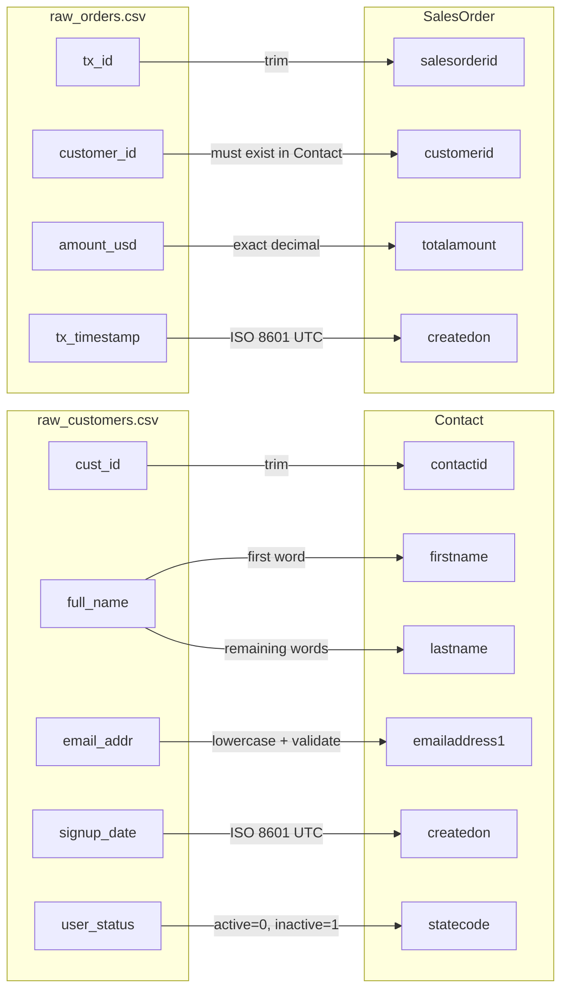
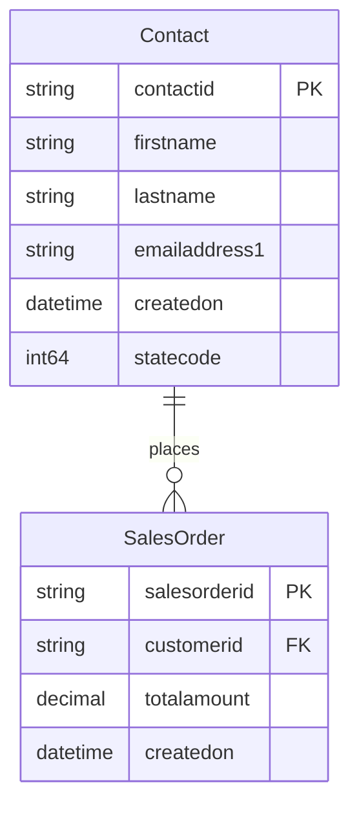
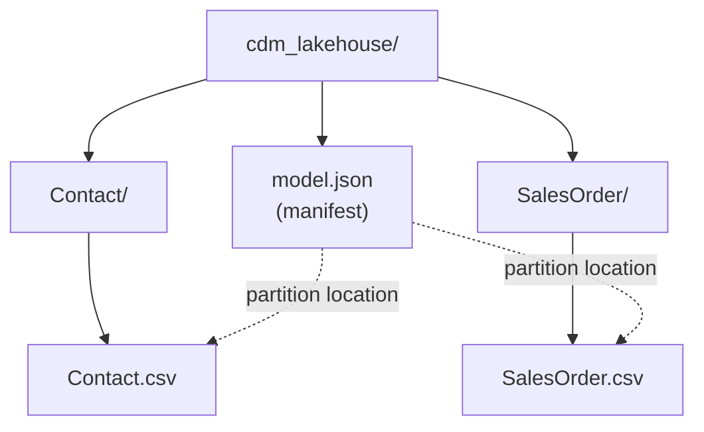

# reeeliance CDM Pipeline

A lightweight Python ETL pipeline that ingests raw customer and order CSV files,
cleans and validates them, and maps them to **Microsoft Common Data Model (CDM)**
entities (`Contact` and `SalesOrder`). The pipeline writes the clean data into a
CDM folder structure and generates a compliant `model.json` manifest.

## Pipeline Overview



## Project Structure

```
reeeliance-cdm-pipeline/
├── data/raw/                  # Raw input CSVs (from the assignment's mock data)
├── src/
│   ├── config.py              # Paths and mapping rules
│   ├── extract.py             # Read raw CSVs as text
│   ├── transform.py           # Clean, validate and map to CDM entities
│   ├── load.py                # Write CDM CSVs to the lakehouse
│   ├── manifest.py            # Generate model.json
│   └── main.py                # Run the full pipeline
├── cdm_lakehouse/             # Output: CDM entities + model.json
├── logs/                      # pipeline.log (created at runtime)
└── requirements.txt
```

## Setup & Run

**Requirements:** Python 3.10+

```bash
# 1. Clone the repository
git clone https://github.com/poojanethraa-afk/reeeliance-cdm-pipeline.git
cd reeeliance-cdm-pipeline

# 2. Create and activate a virtual environment
python -m venv .venv
.venv\Scripts\activate        # Windows
source .venv/bin/activate     # macOS / Linux

# 3. Install dependencies
pip install -r requirements.txt

# 4. Run the pipeline
python src/main.py
```

The pipeline reads `data/raw/`, writes the CDM entities and `model.json` to
`cdm_lakehouse/`, and logs every step to the terminal and to `logs/pipeline.log`.

## Source-to-Target Mapping



## Entity Relationship Diagram



One `Contact` can place many `SalesOrder` records (1:N).
`SalesOrder.customerid` is a foreign key to `Contact.contactid`.

## Storage Layout



`model.json` sits at the root of the lakehouse and describes both entities.
Each entity has its own folder, and the manifest's `partitions.location` points
to the CSV file relative to the lakehouse root (e.g. `Contact/Contact.csv`).
The manifest also defines the relationship `SalesOrder.customerid → Contact.contactid`.

## Data Quality Rules

| Rule | Example in the input | Handling |
|---|---|---|
| Trim whitespace | `"  Charlie Brown"` | Split into `Charlie` / `Brown` |
| Lowercase emails | `JOHN.SMITH@DOMAIN.COM` | `john.smith@domain.com` |
| Invalid email format | `invalid-email-format` (CST-003) | Set to empty, logged as warning |
| Mixed date formats | `2023-02-20 14:15:00`, `2023-03-05` | Normalized to `YYYY-MM-DDTHH:MM:SSZ` |
| Case-insensitive status | `ACTIVE` (CST-004) | Mapped to `statecode` 0 |
| Orphan orders | `ORD-1005` → `CST-999` | Logged as warning, not loaded |

Example log output:

```
WARNING | transform | Invalid email for contact_id CST-003: invalid-email-format
WARNING | transform | Orphan order ORD-1005 for unknown customer_id CST-999
```

## Design Decisions & Assumptions

- **Raw data stays raw:** files are read with `dtype=str`; all conversions happen in `transform.py`, where they are visible and logged.
- **Bad values do not stop the pipeline:** invalid emails, dates, amounts or statuses become empty and are logged, the rest of the record is kept.
- **Orphan orders are excluded** from `SalesOrder.csv` so that every `customerid` references an existing `Contact` (referential integrity).
- **Dates without a time zone are treated as UTC.**
- **Amounts use `Decimal`** instead of `float` to avoid rounding errors with money.
- **Name split:** first word = first name, remaining words = last name. This works for the given data but not for multi-word first names; ideally the source system would deliver first and last name separately.
- **Simple email check:** the pattern `something@something.something` catches common errors; a production system would use stricter validation.
- **CST-005** is split across two lines in the assignment PDF; it is treated as a single record.
- The raw input files in `data/raw/` were taken from the "Input Mock Data" section of the assignment.